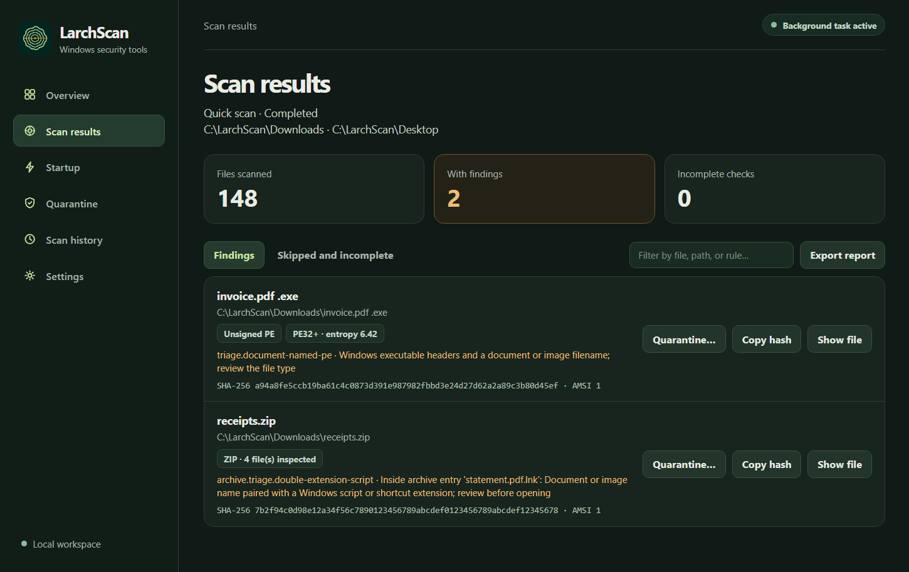
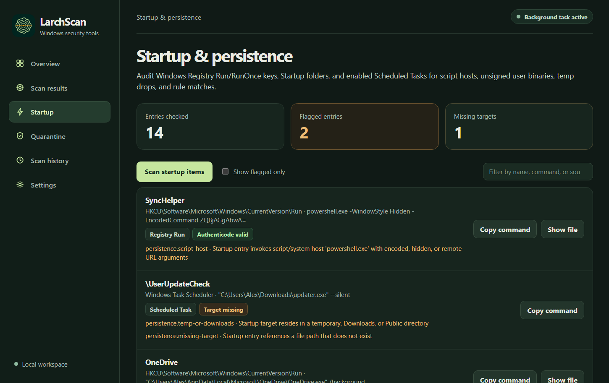

<div align="center">


# LarchScan

### Inspect files, audit startup persistence, and manage quarantine on Windows.

An open-source desktop & CLI security triage tool with ZIP archive inspection, Authenticode & PE entropy checks, YARA-style signed pattern bundles, startup auditing, background scheduling, and reversible quarantine. Built in Rust.

[](https://github.com/Axlirr/larchscan/releases/tag/v0.4.0)
[](https://github.com/Axlirr/larchscan/releases/tag/v0.4.0)
[](LICENSE)

**[Download Installer for Windows](https://github.com/Axlirr/larchscan/releases/download/v0.4.0/LarchScan-0.4.0-Setup.exe)** · [Portable ZIP](https://github.com/Axlirr/larchscan/releases/download/v0.4.0/larchscan-0.4.0-windows-x64.zip) · [Checksums](https://github.com/Axlirr/larchscan/releases/download/v0.4.0/larchscan-0.4.0-SHA256SUMS.txt) · [Quick start](#quick-start) · [Documentation](#documentation)

</div>

## Overview

Choose a file, folder, system drive, or Windows startup audit. LarchScan inspects local files and `.zip` archive interiors, verifies Windows Authenticode signatures and PE section entropy, checks YARA-style pattern rules and SHA-256 indicators, audits Registry `Run`/`RunOnce` keys, Startup folders, and Scheduled Tasks, and optionally queries your installed Windows antimalware provider via AMSI. Review every explanation before quarantining, restoring (with Mark-of-the-Web intact), or exporting a JSON report.


## What's new in v0.4.0

| Feature | What you can do |
| --- | --- |
| **Startup & persistence audit** | Inspect Windows Registry `Run`/`RunOnce` (HKCU & HKLM), User & Common Startup folders, and enabled Scheduled Tasks for script hosts, temp/Downloads drops, unsigned user-space binaries, missing targets, and rule matches (`Startup` tab & `larchscan startup`). |
| **Safe in-memory ZIP inspection** | Inspect files inside `.zip` archives without extracting to disk (bounded to 256 files / 8 MiB per entry / 32 MiB total uncompressed) to catch nested `.pdf.lnk`, `.pdf .exe`, BiDi, hash, and pattern threats. |
| **Authenticode & PE entropy checks** | Verify embedded Windows Authenticode signatures via `WinVerifyTrust` (offline/no-UI), detect tampered signatures (`triage.invalid-authenticode`), and flag unsigned executables with high-entropy or packed code sections (`triage.packed-unsigned-pe`). |
| **YARA-style pattern rules & Ed25519 signing** | Load `larchscan-rules/1` bundles with `ascii`, `ascii_nocase`, `hex`, and `utf16le` pattern rules, extension/PE/entropy filters, and optional fail-closed Ed25519 signature verification (`larchscan rules keygen/sign/verify` + trusted public key in Settings). |
| **Background Task Scheduler & System Tray** | Register a per-user Windows Scheduled Task (`LarchScan.exe --background-quick`) so scheduled quick scans run even when LarchScan is closed, and optionally keep LarchScan in the Windows system tray. |

## Screenshots

<details>
<summary>Inside the app</summary>
<table>
<tr>
<td width="50%"><br><strong>Scan results</strong></td>
<td width="50%"><br><strong>Startup &amp; persistence</strong></td>
</tr>
<tr>
<td width="50%"><br><strong>Quarantine vault</strong></td>
<td width="50%"><br><strong>Scanner settings</strong></td>
</tr>
</table>
</details>

## Quick start

1. Download and run **[LarchScan-0.4.0-Setup.exe](https://github.com/Axlirr/larchscan/releases/download/v0.4.0/LarchScan-0.4.0-Setup.exe)** (installs per-user without admin rights; or download the [Portable ZIP](https://github.com/Axlirr/larchscan/releases/download/v0.4.0/larchscan-0.4.0-windows-x64.zip) if you prefer no installation).
2. Verify the download against [larchscan-0.4.0-SHA256SUMS.txt](https://github.com/Axlirr/larchscan/releases/download/v0.4.0/larchscan-0.4.0-SHA256SUMS.txt):
   ```powershell
   Get-FileHash .\LarchScan-0.4.0-Setup.exe -Algorithm SHA256
   ```
3. Open **LarchScan** from the Start Menu.
4. Click **Start quick scan** (Downloads and Desktop), click **Scan startup** to audit Windows persistence, or choose a file/folder. To test the full scan-and-quarantine flow safely, select a copy of `examples/demo.txt` from the install folder (`demo.fixture`).

> **Windows SmartScreen notice:** The current release is unsigned, so Windows Defender SmartScreen may show *"Windows protected your PC"* on first launch. Click **More info → Run anyway** after verifying the SHA-256 checksum. Requires Microsoft Edge WebView2 Runtime ([WebView2 download](https://developer.microsoft.com/microsoft-edge/webview2/)).

## Documentation

- [Desktop guide](docs/desktop-guide.md) covers installation, scans, startup auditing, ZIP/Authenticode checks, Task Scheduler, system tray, signed rules, and quarantine.
- [CLI guide](docs/cli-guide.md) covers `scan`, `startup`, `quarantine`, `list`, `restore`, `delete`, `rules keygen/sign/verify`, JSON Lines schemas, and the `.lsq` archive format.
- [Research notes](RESEARCH.md) describe the initial endpoint research, architecture, and evaluation scope.

### Build and package from source

On Windows x64, use the Rust 1.92+ MSVC toolchain, Visual Studio C++ Build Tools, a Windows 10/11 SDK (`rc.exe`), and [Inno Setup 6](https://jrsoftware.org/isinfo.php) (`ISCC.exe`, optional for building the Setup `.exe`).

```powershell
cargo build --locked --release --features desktop --bins
cargo run --locked --features desktop --bin larchscan-desktop
cargo test --locked --all-features
cargo clippy --locked --all-targets --all-features -- -D warnings
.\scripts\package-release.ps1
```

LarchScan provides on-demand/scheduled file triage and startup auditing. It has no kernel real-time blocking driver or maintained commercial threat feed; keep Windows Defender or another real-time AV enabled alongside it. [License](LICENSE)
