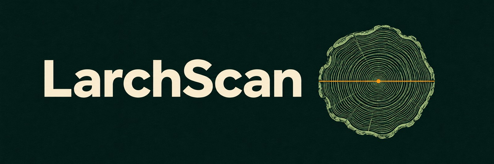
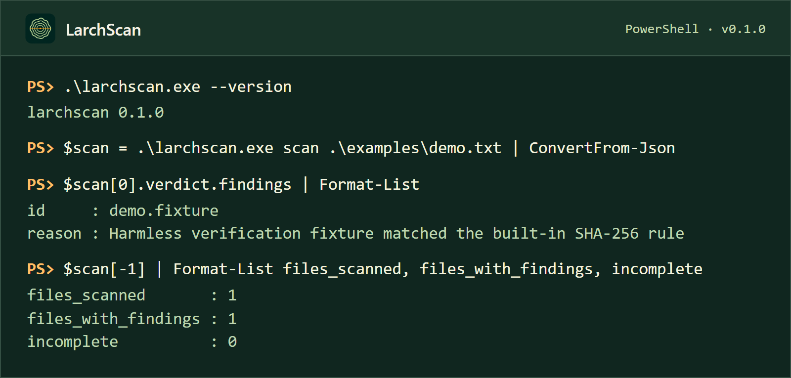

# LarchScan

**LarchScan is a Windows command-line tool for checking suspicious files.** Choose a file or folder, see why each file was flagged, and decide what to quarantine. It runs on demand and is written in Rust.

**[Download the Windows x64 preview](https://github.com/Axlirr/larchscan/releases/download/v0.1.0/larchscan-0.1.0-windows-x64.zip)** · [Release notes and checksums](https://github.com/Axlirr/larchscan/releases/tag/v0.1.0) · [CLI guide](docs/cli-guide.md)

## Try your first scan

Extract the Windows ZIP, open PowerShell in the extracted folder, and scan the harmless sample included with the download.

```powershell
.\larchscan.exe scan .\examples\demo.txt
```

Look for `demo.fixture`. That rule recognizes the sample by its SHA-256 fingerprint. The summary should show one file scanned, one file with a finding, and zero incomplete checks. Exit code `1` means a rule matched.



*Output from the released CLI. The PowerShell commands shown above format its JSON output for reading.*

## What can it catch?

A file called `invoice.pdf.exe` might look like a document at a glance. LarchScan checks the filename alongside the file's Windows executable headers and flags that combination for review. A filename mismatch alone does not establish that a file is malware.

You can also supply a list of known file fingerprints with `--rules`, or use `--amsi` to request a verdict from the antimalware provider installed on your Windows machine. Each result includes the file's fingerprint and the reason for any finding. Skipped files appear in the report.

## What happens when I quarantine a file?

1. **Review the finding.** Copy the SHA-256 fingerprint from the scan.
2. **Quarantine the matching file.** LarchScan checks the fingerprint again, saves a recovery copy, and verifies it before removing the original.
3. **Restore if needed.** Choose a new destination. LarchScan verifies the archived contents and keeps the recovery copy.

The preview supports local NTFS files up to 32 MiB. Files with extra data streams, including some downloaded files, can be scanned but are excluded from quarantine. The guide includes a full quarantine-and-restore example and explains how to store the vault. [Read the CLI guide](docs/cli-guide.md)

## Development

Build on Windows x64 with Rust, the Visual Studio C++ build tools, and a Windows SDK.

```powershell
cargo build --locked --release
cargo test --locked --release
```

Eight integration tests cover scanning and recovery with harmless files, including changed files, damaged archives, and restore collisions. The project is available under the MIT license. [Research and test scope](RESEARCH.md) · [License](LICENSE)
