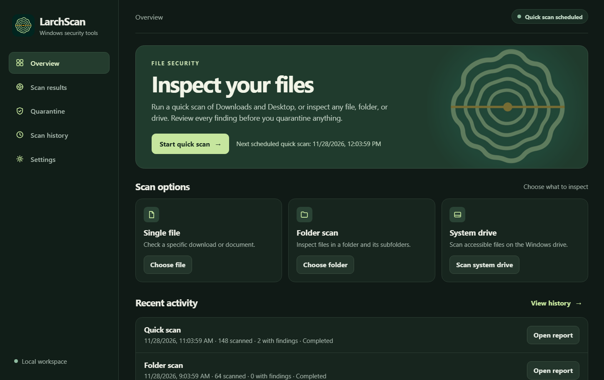
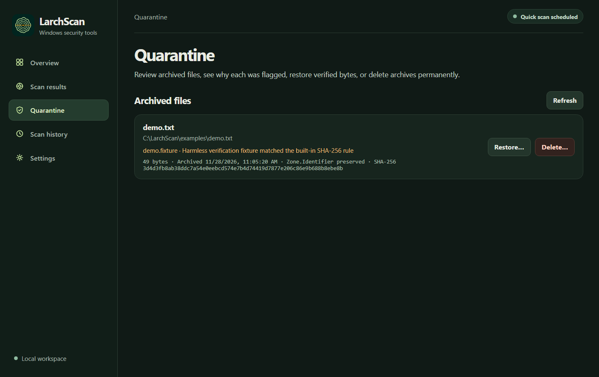
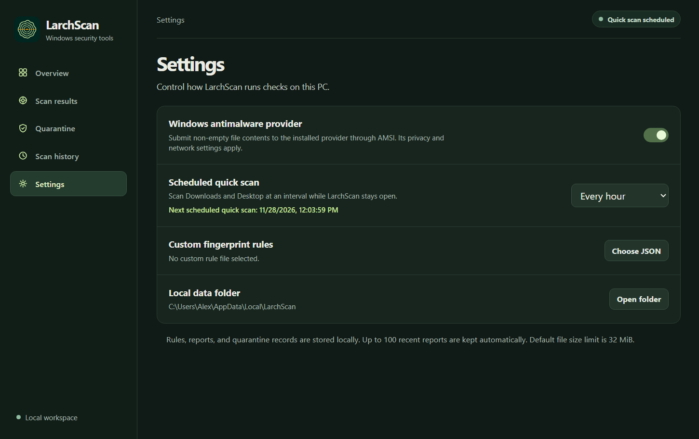

<div align="center">


# LarchScan

### Inspect files, understand findings, and manage quarantine on Windows.

An open-source desktop scanner with file and folder scans, reviewable findings, and reversible quarantine. Built in Rust.

[](https://github.com/Axlirr/larchscan/releases/tag/v0.3.0)
[](https://github.com/Axlirr/larchscan/releases/tag/v0.3.0)
[](LICENSE)

**[Download Installer for Windows](https://github.com/Axlirr/larchscan/releases/download/v0.3.0/LarchScan-0.3.0-Setup.exe)** · [Portable ZIP](https://github.com/Axlirr/larchscan/releases/download/v0.3.0/larchscan-0.3.0-windows-x64.zip) · [Checksums](https://github.com/Axlirr/larchscan/releases/download/v0.3.0/larchscan-0.3.0-SHA256SUMS.txt) · [Quick start](#quick-start) · [Documentation](#documentation)

</div>

## Overview

Choose a file, a folder, or the Windows system drive. LarchScan checks what it can read and shows the reason for each finding, including misleading document-named executables, script/shortcut double extensions, Unicode bidirectional filename spoofing, matching SHA-256 fingerprints, and optional Windows antimalware verdicts. Review the evidence before quarantining a file, restore verified bytes with Mark-of-the-Web intact, or export a report to keep a record.



## What's new in v0.3.0

| Feature | What you can do |
| --- | --- |
| **Windows Installer & slim portable ZIP** | Install per-user with Start Menu shortcut, optional Desktop shortcut, optional CLI `PATH`, and Add/Remove Programs uninstaller (`LarchScan-0.3.0-Setup.exe`), or use the clean 5-file portable ZIP. |
| **Mark-of-the-Web quarantine preservation** | Quarantine browser downloads and extracted ZIP files that carry a Windows `Zone.Identifier` stream, and restore the exact stream alongside the verified file bytes (`larchscan/2`, backward-compatible with `larchscan/1`). |
| **Expanded explainable triage** | Detects space-padded double-extension PEs (`invoice.pdf .exe`), broader document/archive/loader extensions, document-named script/shortcut launchers (`triage.double-extension-script`), and Unicode BiDi/RTLO spoofed filenames (`triage.bidi-filename`). |
| **Improved desktop triage & quarantine** | View finding reasons and archive timestamps in Quarantine, permanently delete archived items, filter findings and skipped rows, copy SHA-256 hashes, reveal files in File Explorer, manage history, and control active scans from a global banner. |
| **Cleaner Windows integration & CLI** | Embedded app icon, `VERSIONINFO`, PerMonitorV2 DPI and long-path manifest, non-disruptive read-only file sharing, clean 0-byte AMSI handling, resilient vault listing, and CLI `delete`, `--max-mb`, and `--exclude`. |

## Screenshots

<details>
<summary>Inside the app</summary>
<table>
<tr>
<td width="50%"><br><strong>Scan results</strong></td>
<td width="50%"><br><strong>Quarantine vault</strong></td>
</tr>
<tr>
<td colspan="2"><br><strong>Scanner settings</strong></td>
</tr>
</table>
</details>

## Quick start

1. Download and run **[LarchScan-0.3.0-Setup.exe](https://github.com/Axlirr/larchscan/releases/download/v0.3.0/LarchScan-0.3.0-Setup.exe)** (installs per-user without admin rights; or download the [Portable ZIP](https://github.com/Axlirr/larchscan/releases/download/v0.3.0/larchscan-0.3.0-windows-x64.zip) if you prefer no installation).
2. Verify the download against [larchscan-0.3.0-SHA256SUMS.txt](https://github.com/Axlirr/larchscan/releases/download/v0.3.0/larchscan-0.3.0-SHA256SUMS.txt) if desired:
   ```powershell
   Get-FileHash .\LarchScan-0.3.0-Setup.exe -Algorithm SHA256
   ```
3. Open **LarchScan** from the Start Menu.
4. Select **Start quick scan** (Downloads and Desktop), or choose a file or folder. To verify the full scan-and-quarantine workflow safely, select a copy of `examples/demo.txt` from the install folder. The expected finding is `demo.fixture`, and it can be quarantined, inspected, restored, or deleted even when carrying a Windows `Zone.Identifier` stream.

> **Windows SmartScreen notice:** The current release is unsigned, so Windows Defender SmartScreen may show *"Windows protected your PC"* on first launch. Click **More info → Run anyway** after verifying the SHA-256 checksum. LarchScan also requires Microsoft Edge WebView2 Runtime (pre-installed on Windows 11 and most Windows 10 systems; [WebView2 download](https://developer.microsoft.com/microsoft-edge/webview2/)).

## Documentation

- [Desktop guide](docs/desktop-guide.md) covers installation, scan options, findings, quarantine/restore/delete, `LARCHSCAN_DATA_DIR`, reports, and current limits.
- [CLI guide](docs/cli-guide.md) covers the command-line executable included under `tools/`, flags, JSON Lines event schemas, and the `.lsq` archive format.
- [Research notes](RESEARCH.md) describe the initial release-artifact research, design decisions, and evaluation scope.

### Build and package from source

On Windows x64, use the Rust MSVC toolchain, Visual Studio C++ Build Tools, a Windows 10/11 SDK (`rc.exe`), and [Inno Setup 6](https://jrsoftware.org/isinfo.php) (`ISCC.exe`, optional for building the Setup `.exe`).

```powershell
cargo build --locked --release --features desktop --bins
cargo run --locked --features desktop --bin larchscan-desktop
cargo test --locked --all-features
cargo clippy --locked --all-targets --all-features -- -D warnings
.\scripts\package-release.ps1
```

LarchScan provides on-demand and scheduled file scans. The current release has no real-time blocking or maintained signature feed. [License](LICENSE)
